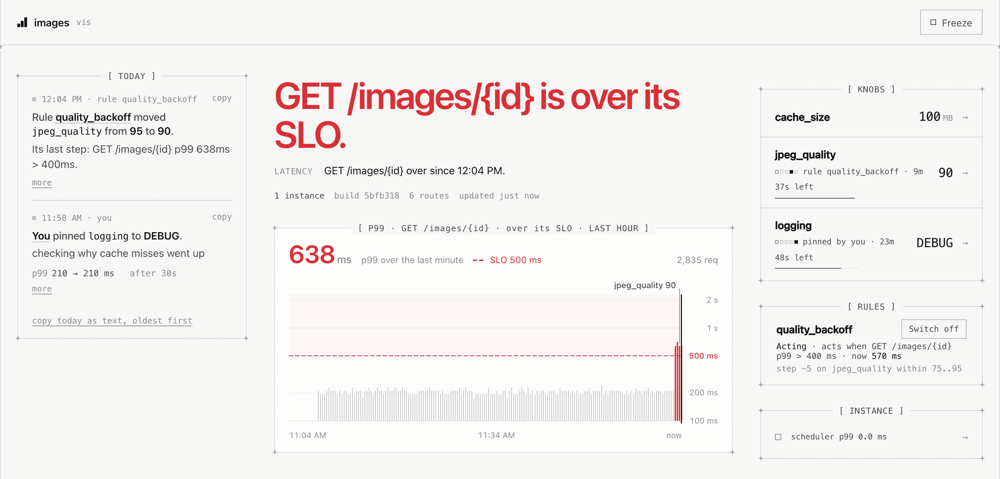
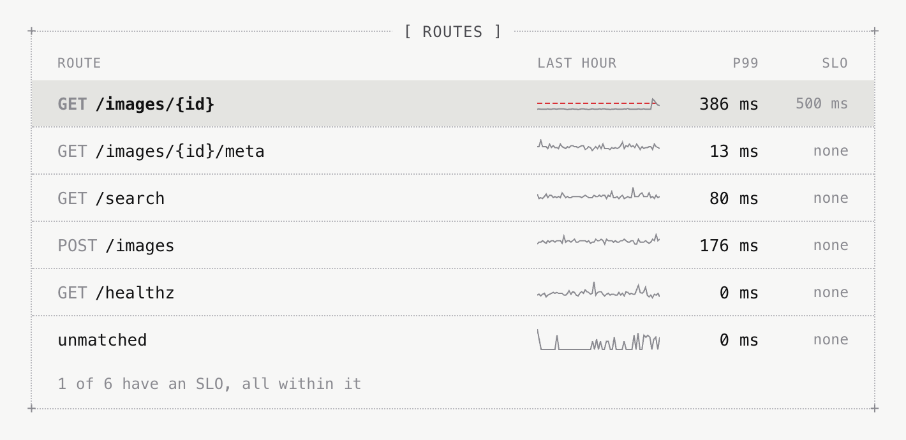
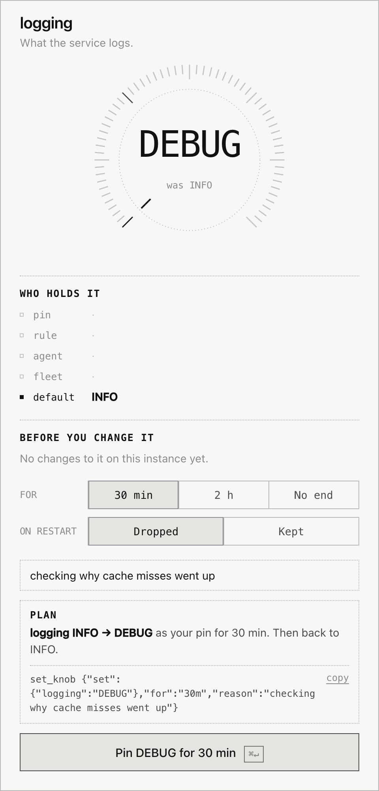
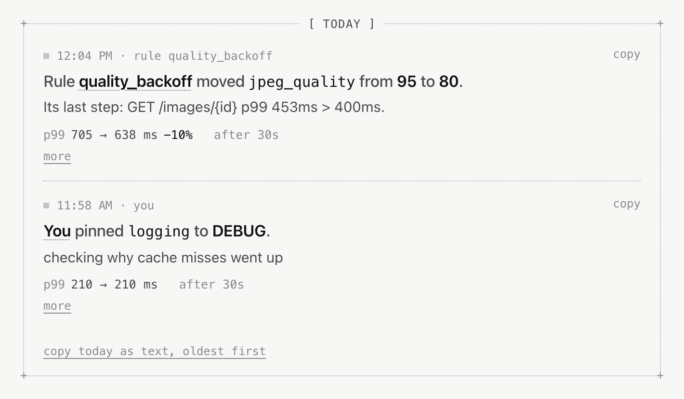

# vis

A live dashboard, SLOs and runtime knobs for Go services, for people and agents. No collector, no cloud.

[](https://www.youtube.com/watch?v=DxnJ5UVggow)

Ollama adopts vis: two lines, a few comments, tuned while it runs, kept in its objective by an agent on call.

## Install

```sh
go get github.com/tfcace/vis
```

## Screenshots

An image service under simulated load, declared like the [Tune](#tune) example below with `p99=500ms` on `GET /images/{id}`: a minute into a slowdown, and after it.

<picture>
  <source media="(prefers-color-scheme: dark)" srcset="docs/images/breach-dark.png">
  
</picture>

A breach. GET /images/{id} is over its 500 ms objective, and quality_backoff has stepped jpeg_quality from 95 to 90 under a 10 minute lease. It keeps stepping until p99 is back under 400 ms.

<picture>
  <source media="(prefers-color-scheme: dark)" srcset="docs/images/routes-dark.png">
  
</picture>

Every route's p99 over the last hour, and its objective if it has one. Requests no route matched get a row too.

<picture>
  <source media="(prefers-color-scheme: dark)" srcset="docs/images/knob-dark.png">
  
</picture>

Turning logging up to DEBUG. Before anything changes, the plan says what will hold and for how long, and shows the same change as an agent would send it.

<picture>
  <source media="(prefers-color-scheme: dark)" srcset="docs/images/today-dark.png">
  
</picture>

Today: every change, with what it did. The rule's first step took p99 from 705 to 638 ms. The DEBUG pin left it where it was.

## See

```go
func hello(w http.ResponseWriter, r *http.Request) { w.Write([]byte("hello")) }

func main() {
	mux := http.NewServeMux()
	mux.HandleFunc("GET /hello", hello)

	ctx, stop := signal.NotifyContext(context.Background(), os.Interrupt, syscall.SIGTERM)
	defer stop()
	if err := vis.Start(ctx, vis.Service("myservice")); err != nil {
		log.Fatal(err)
	}
	defer vis.Stop()
	srv := &http.Server{Addr: ":8080", Handler: vis.HTTP(mux)}
	go srv.ListenAndServe()
	<-ctx.Done()
	srv.Shutdown(context.Background())
}
```

```sh
go run .
open http://localhost:7071
```

| router | wrap it with |
| --- | --- |
| `net/http` `ServeMux` | `vis.HTTP(mux)` |
| gin | `r.Use(visgin.Middleware())`, from `github.com/tfcace/vis/integrations/visgin` |
| echo | `e.Use(visecho.Middleware())`, from `github.com/tfcace/vis/integrations/visecho` |
| any other | `vis.HTTP(h, vis.RouteName(func(r *http.Request) string { ... }))` |

| on the dashboard | |
| --- | --- |
| latency | p99 of every route, the last hour |
| runtime | CPU and throttling, scheduler wait, GC, goroutines |
| memory | use and the live heap; against the limit and when it gets there, with one: a cgroup's (a container, a Kubernetes pod, systemd `MemoryMax`), Lambda's memory size, or `GOMEMLIMIT` |
| restarts | why the last process died, and what it took with it |
| today | every change, with what it did |

## Judge

```go
//go:generate go tool vis gen

// vis:slo p99=500ms
func hello(w http.ResponseWriter, r *http.Request) { w.Write([]byte("hello")) }
```

```sh
go get -tool github.com/tfcace/vis/cmd/vis
go generate ./...
```

| `p99=500ms` on `GET /hello` | |
| --- | --- |
| headline | "All good.", or "Latency is over the SLO." |
| latency chart | the objective as a red dashed line, the time over it shaded |
| impact reports | each change judged by what it did to the objective's route |
| rules | `when="slo.p99 > 400ms"` acts before the objective is missed |
| agents | `describe` and `fleet` say whether it is met |
| `vis vet` | an objective whose route never serves |

## Tune

```go
// vis:knob range=1..16384 default=100 unit=MB uses=memory pull=agent
var CacheSize vis.Int // Memory for cached images.

// vis:knob range=1..100 default=95 uses=cpu pull=agent,rule
// vis:rule name=quality_backoff when="slo.p99 > 400ms" for=30s do=step(-5) cooldown=30s lease=10m
var JPEGQuality vis.Int // JPEG quality of resized images.

// vis:knob pull=agent
var Logging vis.LogLevel // What the service logs.

// vis:signal unit=images/s
var OriginFetches vis.Gauge // Images fetched from origin servers per second.
```

```go
q := JPEGQuality.From(r.Context())
CacheSize.Bind(func(mb int) { cache.Resize(mb * 1_000_000) })
logger := slog.New(slog.NewTextHandler(os.Stderr, &slog.HandlerOptions{Level: Logging}))
```

| every change | |
| --- | --- |
| bounded | within the declared range |
| leased | ends on its own; a person may pin it with no end |
| audited | who, why, when |
| measured | what it did to latency, CPU and memory |

## Agents

| agent | give it |
| --- | --- |
| adopting vis in your code | "Read `go doc github.com/tfcace/vis`, then adopt vis." The guide is the package doc: four adoption steps, every directive, and how to check the result with `vis vet` |
| on call | the MCP server below; its instructions, its tools' descriptions and `describe` show how to look before acting |

```sh
VIS_TOKENS=s3cret=agent:oncall:act go run .
```

```json
{"mcpServers": {"vis": {"type": "http", "url": "http://127.0.0.1:7070",
  "headers": {"Authorization": "Bearer s3cret"}}}}
```

## Check

| command | run it | it catches |
| --- | --- | --- |
| `go tool vis vet ./...` | before a commit, in CI | directives `vis gen` can't read; `vis_gen.go` out of date; a knob read before it is declared; a rule in the wrong unit or outside its knob's range; an SLO on a route that never serves |
| `go tool vis diff [ref]` | reviewing a change | knobs, signals, SLOs and rules added, removed or changed since `ref` (default `HEAD`) |
| `go tool vis diff -check` | in CI on a pull request | exit 1 when automation gets more room: a new writer, a wider range, a new rule, a longer lease, a slower p99, a removed SLO |

## Surfaces

| surface | default address | access |
| --- | --- | --- |
| dashboard | `127.0.0.1:7071` | no login; acts as `VIS_UI_USER`; keep it on localhost |
| MCP | `127.0.0.1:7070` | read-only without `VIS_TOKENS` |
| fleet gossip | `:7946` | only with `VIS_CLUSTER_KEY` |

## Configuration

| variable | option | default |
| --- | --- | --- |
| `VIS_LISTEN` | `MCPAt(addr)` | `127.0.0.1:7070`; `""` off |
| `VIS_UI_LISTEN` | `UIAt(addr)` | `127.0.0.1:7071`; `""` off |
| `VIS_TOKENS` | `Tokens(...)` | none: read-only |
| `VIS_UI_USER` | `UIUser(id)` | the OS user |
| `VIS_UI_HOSTS` | `UIHosts(...)` | localhost only |
| `VIS_STATE_DIR` | `StateDir(dir)` | the temp dir; an `emptyDir` on Kubernetes |
| `VIS_CLUSTER_KEY` | `ClusterKey(key)` | none: no fleet |
| `VIS_SEEDS` | `Seeds(addrs...)` | none |
| `VIS_PEER_LISTEN` | `PeerAt(addr)` | `:7946` |
| `VIS_PEER_ADVERTISE` | `PeerAdvertise(addr)` | the listen address |
| `VIS_INSTANCE_NAME` | `InstanceName(name)` | the hostname |
| `VIS_FLEET_WAIT` | `FleetWait(d)` | `2s` |

## Status

| area | v0.1 |
| --- | --- |
| dashboard, SLOs, knobs, layers, leases, audit, `vis gen`, `vis vet`, `vis diff` | stable |
| rules, impact reports, memory forecast, restart stories, MCP tools | stable, still growing |
| fleet, rollouts | experimental |

## Example

[`examples/cacheproxy`](examples/cacheproxy): a caching proxy with knobs, signals, rules and an SLO.

## Reference

```sh
go doc github.com/tfcace/vis
```

## License

[MIT](LICENSE)
